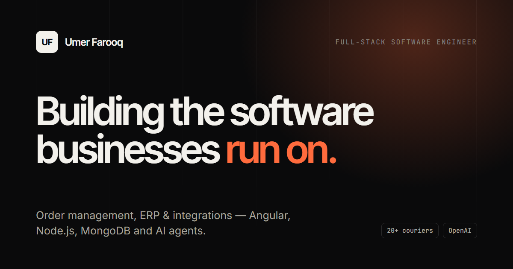

# Umer Farooq — Portfolio

Personal portfolio of **Umer Farooq**, Full-Stack Software Engineer (MEAN Stack) based in Karachi, Pakistan.

🔗 **Live:** https://your-portfolio-link.vercel.app

It showcases production work in order management with AI, ERP, event booking, healthcare and desktop messaging. Every project is presented as a case study, with my role kept clearly separate from the product itself.



---

## About me

I'm a software engineer at **i-Splendid** with 3+ years of experience building business software on **Angular, Node.js, Express.js and MongoDB**. I've also shipped work on .NET, SQL Server, MySQL and Electron.

- **ShipKardo**: full-stack order management system with 20+ courier integrations and selling-channel sync (Shopify, WooCommerce, Daraz, Splendid Accounts). It also has AI features: natural-language reporting on the OpenAI API, and AI agents (in progress).
- **Splendid Accounts**: Angular frontend of a complete ERP. I built sales and purchase invoices and returns, POS, inventory, CRM, profit & loss reporting, and role-based access control.
- **Mounties**: event and play-area booking portal for an Australian client (Angular, .NET, SQL Server).
- **NurseNova**: healthcare platform. I built the admin panel and the REST APIs consumed by the mobile app (Angular, Node.js, MySQL).
- **WinQo**: Electron desktop app for sending WhatsApp messages, with a local MySQL database.
- 🏆 Employee of the Month at i-Splendid, April 2024.

---

## Features

- Responsive, dark design built from a custom design system (Tailwind CSS v4 tokens)
- Case-study modals for each project, built on the native `<dialog>` element for accessibility
- Integration map showing the selling channels, couriers and AI layer in ShipKardo
- Illustrative UI sketches for proprietary work, so no confidential screenshots are exposed
- Scroll-reveal animations with full `prefers-reduced-motion` support
- Keyboard accessible: skip link, visible focus states and a focus-trapped mobile menu
- SEO-ready: meta tags, Open Graph image, `Person` structured data, and a sitemap and canonical URL generated at build time
- No runtime dependency on external APIs, so the site works even if GitHub's API is down

---

## Tech stack

| Area      | Tools                                      |
| --------- | ------------------------------------------ |
| Framework | React 19 · TypeScript                      |
| Build     | Vite                                       |
| Styling   | Tailwind CSS v4                            |
| Icons     | Lucide                                     |
| Quality   | ESLint · TypeScript strict mode            |
| Hosting   | Vercel (any static host works)             |

---

## Getting started

Requires **Node.js 20.19+** (or 22.12+).

```bash
git clone https://github.com/umerfarooq8743/portfolio.git
cd portfolio
npm install
npm start
```

Then open http://localhost:5173.

| Command             | Description                                  |
| ------------------- | -------------------------------------------- |
| `npm start`         | Start the dev server with hot reload         |
| `npm run build`     | Type-check, then build for production into `dist/` |
| `npm run preview`   | Preview the production build locally         |
| `npm run lint`      | Run ESLint                                   |
| `npm run typecheck` | Run the TypeScript checks                    |

---

## Editing content

All text lives in **`src/data/profile.ts`**: projects, experience, skills, links and stats. Most updates need no component changes.

```
src/
├── data/profile.ts      ← all portfolio content
├── components/          ← page sections (Hero, About, Projects, Experience, …)
├── components/ui/       ← reusable pieces (Reveal, Tag, ButtonLink, icons)
├── hooks/               ← active-section tracking for the navbar
└── index.css            ← design tokens and shared styles
public/                  ← photo, favicon, social preview image
```

---

## Deployment

1. Push this repo to GitHub.
2. Import it on [Vercel](https://vercel.com). Vite is detected automatically: the build command is `npm run build` and the output directory is `dist`.
3. Optional: add a `SITE_URL` environment variable, such as `https://your-domain.com`. The build then adds a canonical link, absolute Open Graph URLs and `sitemap.xml`.

Every push to `main` redeploys the site.

---

## Contact

- **LinkedIn:** [in/umerfarooq-dev](https://www.linkedin.com/in/umerfarooq-dev)
- **GitHub:** [@umerfarooq8743](https://github.com/umerfarooq8743)
- **Email:** s.m.umerfarooq8743@gmail.com

---

© Umer Farooq. All rights reserved. The source code is shared for reference; please don't republish this portfolio as your own.
